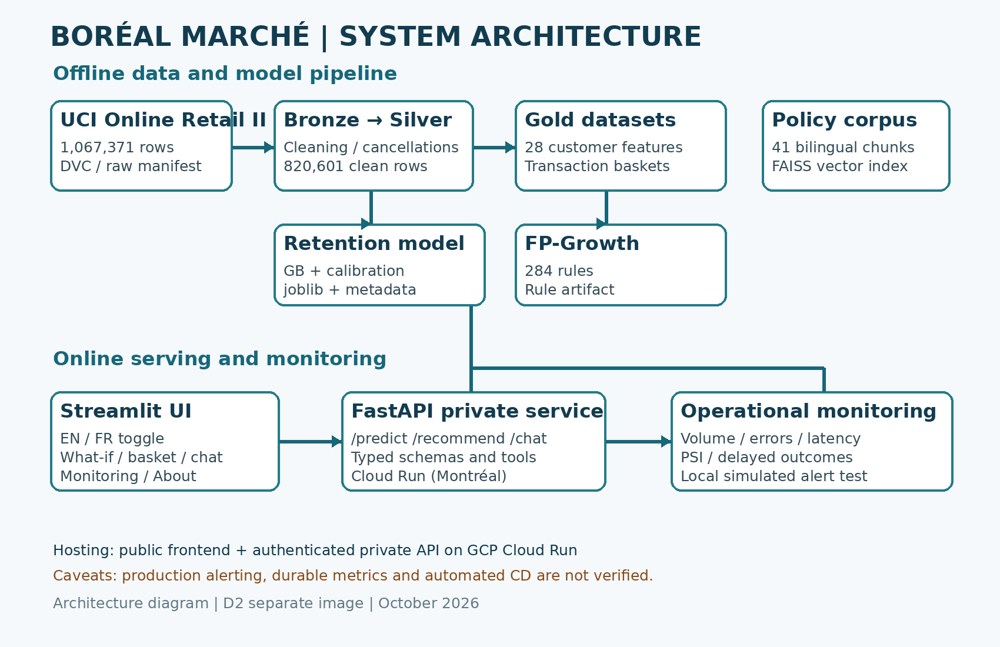

# Boréal Marché — AI Customer Intelligence Platform

An academic capstone project combining customer retention prediction, product recommendations, and a bilingual AI customer assistant.

## Live Application

**Streamlit application:**  
https://aysesonmez-borealmarche-91444056580.northamerica-northeast1.run.app

**Deployment:** Google Cloud Run, Montréal (`northamerica-northeast1`).

The FastAPI backend is private and is accessed through authenticated service-to-service requests from the frontend.

## Project Features

### 1. Customer Retention Prediction

Predicts whether a customer is likely to purchase again within 90 days.

- Model: Calibrated Gradient Boosting Classifier
- Features: 28
- Held-out test customers: 1,052
- PR-AUC: 0.7951
- ROC-AUC: 0.8192
- Brier score: 0.1699
- Decision threshold: 0.73

### 2. Product Recommendation

Uses FP-Growth association rules to recommend products frequently purchased together.

- Association rules: 284
- Hit Rate@5: 5.03%
- Popularity baseline Hit Rate@5: 2.16%

### 3. Bilingual AI Assistant

Supports English and French customer questions.

The assistant uses:
- Retrieval-augmented generation (RAG)
- FAISS vector search
- A policy knowledge base
- Tools for policy retrieval, retention information, product recommendations, and product lookup

## Technology Stack

| Layer | Technology |
|---|---|
| Frontend | Streamlit |
| Backend | FastAPI |
| Machine learning | Python, scikit-learn |
| Recommendations | FP-Growth |
| Retrieval | FAISS |
| Deployment | Google Cloud Run |
| Containers | Docker |
| Data versioning | DVC |

Google Cloud was approved by the instructor as the alternative deployment platform for this capstone project.

## Data

**Source:** UCI Online Retail II.

The project uses a Bronze/Silver/Gold data pipeline:

1. Bronze — original transaction dataset.
2. Silver — cleaned transaction records.
3. Gold — customer-level model features.

The raw dataset is referenced through DVC and is not required to be committed directly to Git.

See `DATA_CARD.md` for data provenance, preparation, and limitations.

## Repository Structure

```text
boreal-marche-customer-intelligence/
├── artifacts/             # Trained model and recommendation rules
├── data/                  # Data pipeline artifacts and DVC pointer
├── docker/                # Container definitions
├── docs/corpus/           # English/French policy knowledge base
├── frontend/              # Streamlit interface
├── reports/               # Evaluation and audit results
├── src/
│   ├── data/              # Data ingestion and cleaning
│   ├── features/          # Customer feature engineering
│   ├── models/            # Retention training and evaluation
│   ├── rag/               # Assistant, retrieval, and tools
│   └── recommendation/    # Market-basket analysis
├── tests/                 # Tests and evaluation questions
├── ARCHITECTURE.md
├── DATA_CARD.md
├── GOVERNANCE_LOI25.md
├── MODEL_CARD.md
├── requirements-api.txt
└── requirements-frontend.txt
```

## Local Setup

Requires Python 3.11 and an environment capable of installing the project dependencies.

Create and activate a virtual environment:

```powershell
python -m venv .venv
.\.venv\Scripts\Activate.ps1
```

Install the application dependencies:

```powershell
pip install -r requirements-api.txt
pip install -r requirements-frontend.txt
```

Start the API:

```powershell
uvicorn src.api:app --reload
```

In another terminal, start the frontend:

```powershell
streamlit run frontend/app.py
```

Some features may require additional local artifacts or environment configuration. The deployed frontend uses authenticated access to the private Cloud Run backend.

## Evaluation

### Retention Model

- PR-AUC: 0.7951
- ROC-AUC: 0.8192
- Brier score: 0.1699

### Product Recommendations

- FP-Growth rules: 284
- Hit Rate@5: 5.03%
- Popularity baseline: 2.16%

### Fairness Audit

The held-out test set contains 1,052 customers.

The audit compares model performance across country, customer-tenure quartiles, and spending quartiles.

Substantial differences were observed across tenure and spending groups. Country-level comparisons were inconclusive because most countries had insufficient test samples.

See `reports/fairness_audit.json` and `GOVERNANCE_LOI25.md`.

## Responsible AI and Privacy

The platform is an academic demonstration using historical retail data. It is not a production system serving real Québec retail customers.

The project documents data provenance, model limitations, fairness risks, privacy considerations, and human oversight requirements.

- `DATA_CARD.md`
- `MODEL_CARD.md`
- `GOVERNANCE_LOI25.md`
- `docs/corpus/privacy_policy.md`

## Project Limitations

- Historical data may not represent current Québec retail customers.
- Fairness disparities require further investigation.
- The application is not certified for production use.
- Production deployment would require additional privacy, security, monitoring, and operational controls.

## Academic Context

**Project:** Boréal Marché — AI Customer Intelligence Platform  
**Course:** 420-977-VA Capstone Project

This repository demonstrates the integration of predictive analytics, recommendation systems, and bilingual AI assistance in a cloud-deployed application.


## System Architecture



The platform integrates customer retention prediction, FP-Growth recommendations, and a bilingual AI assistant using FAISS retrieval. The Streamlit interface and FastAPI backend are deployed on Google Cloud Run.

## Next Steps

- Improve fairness across customer subgroups.
- Expand recommendation coverage and evaluate business impact.
- Add persistent production monitoring and automated deployment.
- Validate performance under higher traffic.
- Strengthen privacy and security controls before production use.

